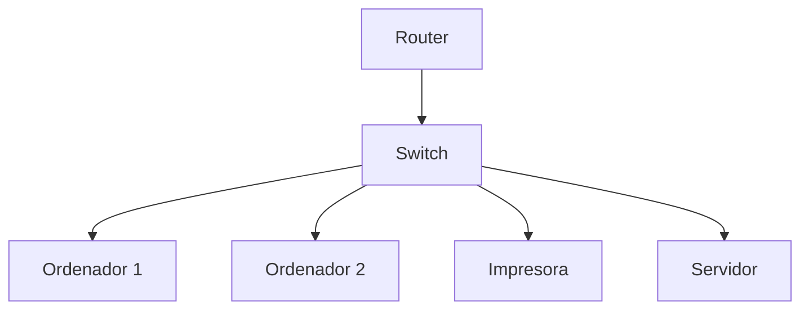

# Grafo de una red informática

## Introducción
Este grafo representa una pequeña red informática.

## Grafo

## Conclusión
El router conecta con el switch, que distribuye la conexión entre los diferentes dispositivos.

